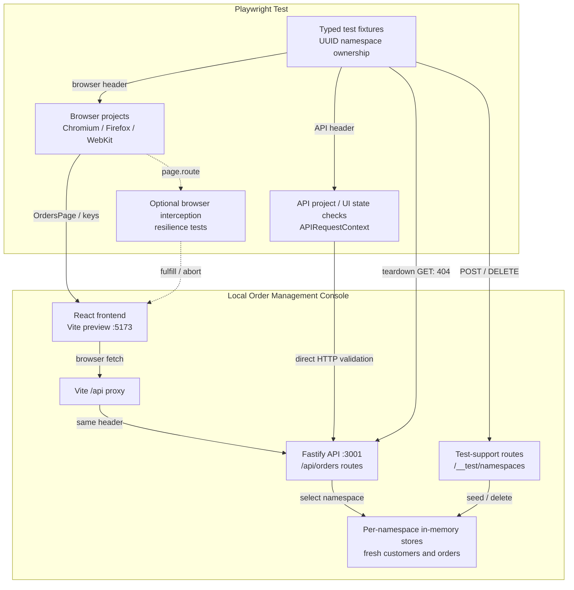

# Architecture decisions

The automation framework is the primary deliverable. The local Order Management
Console provides controlled browser and HTTP behavior without external accounts or
services. See the [README](../README.md) for a short review path and
[test documentation](testing.md) for scenario-level evidence.

## Runtime and test paths

Solid arrows show fixture setup and real execution/HTTP/store paths. Dotted arrows
show optional browser interception. The normal browser fetch path
passes through Vite; a page.route handler can replace or abort a selected response
locally, or forward/fetch it through that same proxy. Direct APIRequestContext
calls go to port 3001 and bypass both page.route and Vite.

Test-support routes require `NODE_ENV=test` and `ENABLE_TEST_SUPPORT=true`.
Management calls create/delete namespaces; teardown's separate scoped GET verifies
that the deleted store is inaccessible. Stores persist only within the running
Fastify process. The diagram shows test mode; normal development uses a default
store and does not register lifecycle routes.

| Diagram element | Source of truth |
| --- | --- |
| Runner, projects, server readiness and shutdown | [playwright.config.ts](../playwright.config.ts) |
| Typed ownership, headers, direct API context, checked teardown | [tests/fixtures/test.ts](../tests/fixtures/test.ts) |
| Browser interactions | [OrdersPage](../tests/pages/orders.page.ts), [keyboard tests](../tests/ui/accessibility.spec.ts) |
| React requests and response validation | [App](../apps/web/src/App.tsx), [orders client](../apps/web/src/api/orders.ts) |
| Vite development/preview proxy | [vite.config.ts](../vite.config.ts) |
| Fastify route/store resolution | [app.ts](../apps/api/src/app.ts), [order routes](../apps/api/src/orders/routes.ts) |
| Test-support lifecycle and fresh stores | [namespace routes](../apps/api/src/test-support/namespaces.ts), [startup guard](../apps/api/src/test-support/config.ts), [seed factory](../apps/api/src/store/seed.ts) |
| Optional fulfilled/aborted/forwarded browser requests | [network resilience tests](../tests/ui/network-resilience.spec.ts) |

## One package, explicit separation

There is one npm package and one lockfile. The API, frontend, test suite, and
tooling each have a strict TypeScript configuration suited to their runtime.
The API compiles with NodeNext modules, the frontend uses Vite/Bundler resolution,
and tests use Playwright's TypeScript transformation plus separate `tsc` checking.
ESLint checks types and floating promises. Application data/rules are never
imported by tests to calculate expected results.

DTO declarations are small and local to each application boundary. Sharing a
business-rule implementation with tests would compromise their independence;
introducing schema code generation is unnecessary for this API's current size.
The frontend validates the small order response shape locally and uses operation-specific
fallback messages for invalid JSON, empty errors, unexpected response bodies, and
network failures. Expected listing cancellation preserves its original rejection.

The dependency set uses React 19, Vite 8, Fastify 5, and Playwright 1.64. TypeScript
6.0.3 was selected within typescript-eslint 8.71.1's declared supported range
(`>=4.8.4 <6.1.0`), rather than choosing the registry's latest TypeScript release
without checking compatibility. Exact direct versions and transitive resolutions
are recorded in `package-lock.json`. Node 22.22.0 is the local/CI baseline.

## Minimal application

Fastify handles HTTP and JSON Schema validation. In-memory stores contain customers
and orders; routes join customer data into order responses. A small transition map
enforces business rules. The frontend displays server-confirmed updates and
refetches the current filtered listing. AbortController prevents obsolete search
responses from replacing the latest result. Listing errors suppress invalid data;
update errors use separate state so existing rows and controls remain usable.

The API error handler converts schema errors, malformed JSON, business errors,
and unknown routes into `{ code, message }` responses. Invalid schemas use 400,
missing resources use 404, and prohibited state transitions use 409. Unexpected
errors are logged and return a generic 500. Fastify's AJV coercion, default
injection, and additional-field removal are disabled for explicit input validation.

The UI presents valid next-status choices for convenience; the backend remains
authoritative and validates every update. Tests explicitly verify an invalid direct
HTTP transition. The fixture app provides neither durable state nor concurrency
control for competing updates to the same order.

## Namespace lifecycle and ownership

`createNamespace` is a **test-scoped** fixture. Its factory allocates a UUID and
creates a store through `POST /__test/namespaces`. The default `namespace` fixture
uses it once; the isolation scenario uses it again for its second store. Each
creation receives fresh objects with the same fixed seed contents.

The overridden `request` fixture constructs an APIRequestContext with the namespace
header and API base URL. The `extraHTTPHeaders` fixture supplies that same namespace
to Playwright's normal browser-context fixture. Contexts are not shared by workers.
Vite forwards `/api` unchanged in development and preview, including custom headers.
UI tests run against built assets and a compiled backend.

The UI update test reads the result directly through the test's API context. If
the browser uses another store or the proxy loses the header, that assertion fails.
The isolation test verifies identical starting orders, changes namespace A, and
asserts A is processing while B remains pending. Both assertions use explicit
test-owned expected objects.

The owning fixture runs teardown in `finally`, attempts deletion for **every**
owned namespace, checks DELETE returned 204, and checks a subsequent scoped GET
returns 404 with `NAMESPACE_NOT_FOUND`. It attaches results and fails teardown if
any deletion verification fails. API contexts are disposed separately. No global
dataset reset, serial suite, or shared worker-level mutable data is needed.

Test-support endpoints are outside `/api`. Server startup requires both
`NODE_ENV=test` and `ENABLE_TEST_SUPPORT=true` to enable them; enabling support
outside test mode fails startup. Disabled support leaves those routes unregistered.
The startup guard is a small function shared with the standalone configuration
regression. That test builds and closes its own apps without changing process.env
or using the Playwright server.
Test-mode `/api` routes reject a missing or unknown namespace rather than falling
back to a default store. `/health` remains available for server readiness.

Both servers bind to `127.0.0.1`. Test-support routes have no authentication and
must not be exposed as a remotely accessible service. Namespaces are test isolation,
not a security boundary. Process termination may skip teardown; disposable backend
shutdown removes remaining in-memory stores. Parallel workers are supported, while
concurrent independent suite invocations need distinct ports and are outside the MVP.

## Test layers and diagnostics

The [test guide](testing.md) owns the coverage inventory and implementation detail:
23 API scenarios and 23 UI scenarios per browser produce 92 Playwright executions.
Six standalone Node regressions run separately. Each test uses independently owned
expected data and namespaces; no worker-level mutable store or global reset is used.

API scenarios and ordinary UI workflows call real local HTTP routes. Browser
resilience tests intercept selected requests, then read Fastify directly to
separate frontend error handling from actual store state. Accessibility checks
combine selected axe rules with keyboard/focus assertions; the
[accessibility audit](accessibility.md) defines automated scope and manual gaps.

The default reporter emits console and HTML results. Failed tests retain traces;
failed browser tests capture screenshots. Tests attach checked namespace cleanup,
and accessibility scans attach compact violations/incomplete checks. Playwright
starts/stops the compiled API and Vite preview using readiness URLs. Existing
servers are not reused, avoiding a manual server with stale code or disabled
test support. Build is required before application tests.

## CI and delivery boundaries

The [Quality workflow](../.github/workflows/quality.yml) uses the pinned Node baseline,
clean install, typecheck, zero-warning ESLint, build, six standalone regressions,
and matching browsers with Linux dependencies. One npm test invocation discovers
all API/UI/accessibility scenarios. It runs with two CI workers, full parallelism,
and zero retries; local runs use four workers. Evidence uploads contain HTML
reports, cleanup/axe attachments, failure traces, and screenshots, retained for
seven days when the job is not cancelled.

There is no sharding, deployment, database service, or runtime secret configuration.
Visual regression, other error routes, Unicode search semantics, and concurrent
writes to the same order remain outside coverage. The
[verification record](verification.md) preserves incremental delivery history,
actual local and hosted-CI results, and the limits of each checkpoint.
